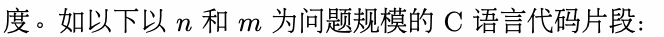
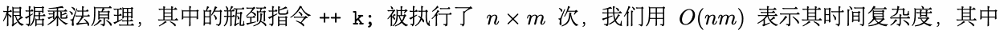
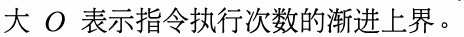
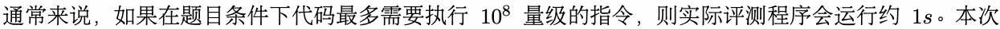
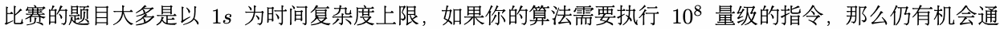
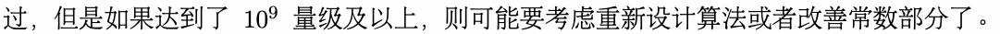
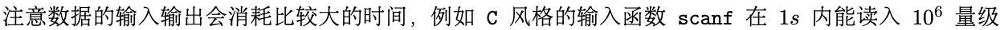
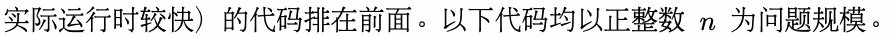
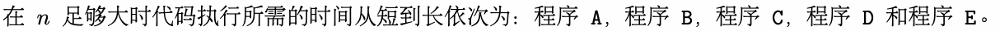

# A. 时间复杂度

输入文件： standard input
出文件：

输出文件： s s t t a a n n d d a a r r d d i o n u p t u p t ut
时间限制： 1 second

时间限制： s1tsaencdoanrdd

空间限制： 256 megabytes

在比赛中你可能会遇见复杂度上的问题，例如一个算法程序运行时间过长，所以在实现算法前，我们会

估算算法的时间复杂度。

关于复杂度，前人有很丰富的理论，这里我们只用最简洁的方式介绍时间复杂度。同一个算法在不同的

计算机上运行的速度会有一定的差别，并且实际运行速度难以在理论上进行计算，实际去测量又比较麻

烦，所以我们通常考虑的不是算法运行的实际用时，而是算法运行所需要进行的基本操作的数量。

影响时间复杂度的最主要因素是循环，我们通常可以通过估算指令循环进行的次数来得到一种时间复杂



```cpp
int k = 0;
for (int i = 0; i < n; ++ i)
 for (int j = 0; j < m; ++ j)
   ++ k;
```













的整数，printf 类似。C++ 的 cin/cout 与 Pyt C hon 的 input/prin s t ca开nf销会更1s大，所以如果10这些方
入可能会超时，则请 格的 入。

法输入可能pr会in超tf时，则请C转++用
C
c风in格/c的out
scanf
Py输th入o。n

## Input

本题没有输入数据。

本题需要你阅读下列代码，并根据时间复杂度的增长速率进行排序，其中需要将增长速率较慢（也就是



```cpp
// ID of this code is A
int k = 0;
for (int i = 1; i <= n; ++ i)
 for (int j = i; j <= n; ++ j)
   ++ k;
// ID of this code is B
int k = 0;
for (int i = 1; i <= n; ++ i)
 for (int j = 1; i * j <= n; ++ j)
   ++ k;
// ID of this code is C
int k = 0;
```

```cpp
for (int i = 1; i <= n; ++ i)
 for (int j = 1; j * j <= n; ++ j)
   ++ k;
// ID of this code is D
int fib(int n) {
 if (n <= 1) {
   return 1;
 }
 return (fib(n - 1) + fib(n - 2)) % 998244353;
}
int result = fib(n);
// ID of this code is E
int arr[n + 1];
int fib(int n) {
 if (n <= 1) {
   return 1;
 }
 if (arr[n] != -1) {
   return arr[n];
 }
 return arr[n] = (fib(n - 1) + fib(n - 2)) % 998244353;
}
for (int i = 1; i <= n; ++ i)
 arr[i] = -1;
int result = fib(n);
```

## Output

输出一行一个字符串，其应当包含大写字母 A，B，C，D 和 E 恰好一次。例如，输出 ABCDE 代表认为
在 足 时代码 行 需的时间从 到长依 为： 序 ， 序 ， 序 ， 序 和 序 。


