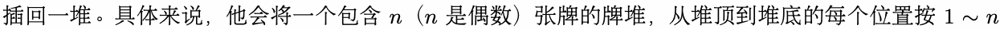
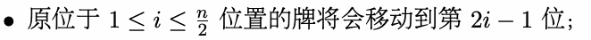
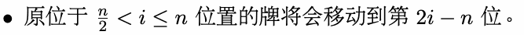
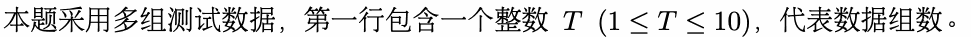
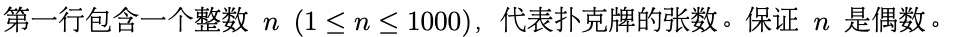
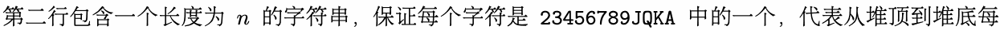
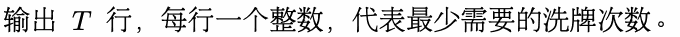

# B. 完美洗牌

输入文件： standard input
出文件：

输出文件： s s t t a a n n d d a a r r d d i o n u p t u p t ut
时间限制： 1 second

时间限制： s1tsaencdoanrdd

空间限制： 256 megabytes

小 F 很擅长洗牌，特别是完美洗牌。小 F 在每次完美洗牌时，会将牌堆对半分成两份，然后将它们再



标号，每次洗牌后：





以包含六张牌的牌堆为例，若其初始顺序为 123456（堆顶至堆底），经过一次完美洗牌后，新的顺序将
变为 。

变为 142536。

现在，小 F 有一堆没有花色的扑克牌（可能有超过四张同一牌面的牌，比如五张 2），按照堆顶到堆底
给定 的 面，他 让你帮他 出最少要洗 少 能回到初 的 。

给定每张牌的牌面，他想让你帮他求出最少要洗牌多少次才能回到初始的状态。

## Input



在每组数据中：





张牌的牌面。

## Output



## Example

### 样例输入

```text
4
4
JQKA
8
23456789
12
223222333232
8
AQAQAQAQ
```

### 样例输出

```text
2
3
2
3
```

## Note

对于第三组测试数据，两次洗牌的结果分别为：

```cpp
      shuffle        shuffle                             
223222333232 −−−−−→ 232333222322 −−−−−→ 223222333232
```

对于第四组测试数据，三次洗牌的结果分别为：

```cpp
      shuffle      shuffle     shuffle                        
AQAQAQAQ −−−−−→ AAQQAAQQ −−−−−→ AAAAQQQQ −−−−−→ AQAQAQAQ
```
