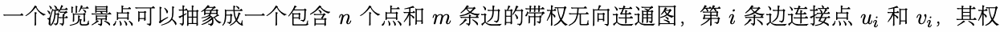
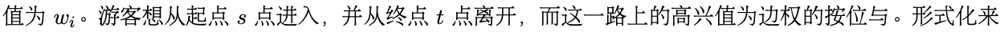
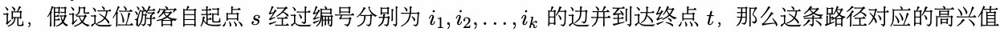
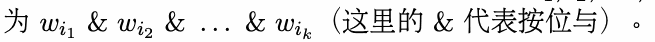
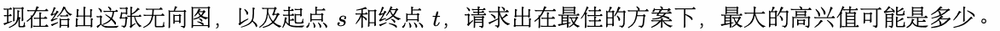
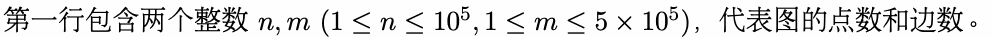
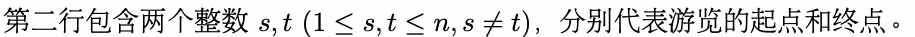
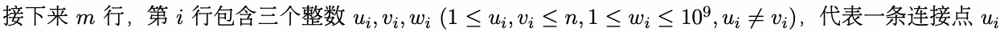
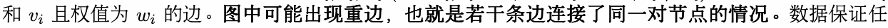
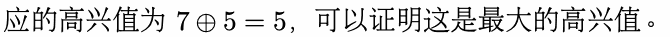

# C. 游览路线

输入文件： standard input
出文件：

输出文件： s s t t a a n n d d a a r r d d i o n u p t u p t ut
时间限制： 1 second

时间限制： s1tsaencdoanrdd

空间限制： 256 megabytes











## Input









意两vi个点都可以w通i过这些路径互相到达。

## Output

一行一个整数，代表最大的高兴值。

## Example

### 样例输入

```text
5 10
5 1
4 1 8
4 5 3
4 3 4
4 2 10
1 4 4
1 2 4
3 5 8
1 5 4
5 2 7
1 2 5
```

### 样例输出

```text
5
```

## Note

对于样例，可以选择从 5 号点通过第 9 条边走到 2 号点，随后通过第 10 条边走到 1 号点。整条路径对
应的 值为 ，可以证明 是最 的 值。



本题输入数据量较大，请使用较快的输入方式。
