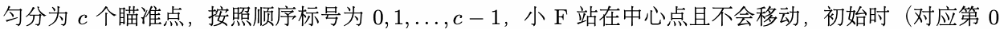
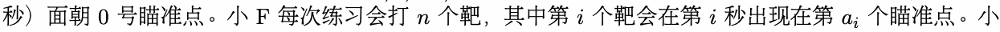
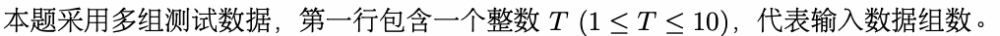
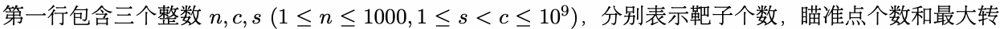
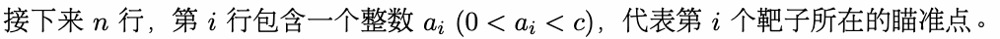
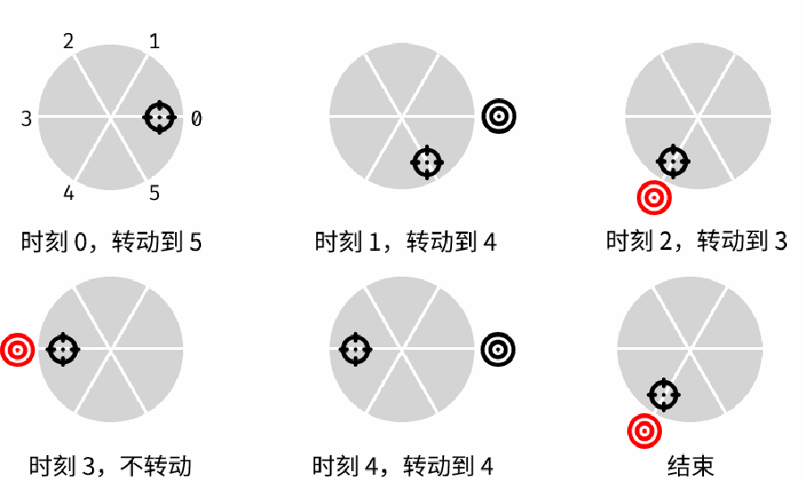

# D. 靶场

输入文件： standard input
出文件：

输出文件： s s t t a a n n d d a a r r d d i o n u p t u p t ut
时间限制： 1 second

时间限制： s1tsaencdoanrdd

空间限制： 256 megabytes

在因为糟糕的枪法被朋友嘲笑后，小 F 决定去靶场苦练自己的枪法。靶场可以看作一个圆，其圆周被均





F 预先知道0了所有靶子的位置，因此规定：n只有在靶子出现的i 一瞬间开枪i并命中，才会a认i 为自己中靶。


朝着某个靶所在的方向，就一s定能命中这个靶）？

## Input



在每组数据中：



动速度。



## Output

对每组数据，输出一行一个整数，代表在最优情况下能命中的靶子数量。

## Example

### 样例输入

```text
2
5 6 1
0 4 3 0 4
11 45 14
13 40 30 1 32 5 22 39 4 19 35
```

### 样例输出

```text
3
6
```

## Note

对于第一个测试数据，以下是一种可能的转动方案：


