# E. 取模

输入文件： standard input
出文件：

输出文件： s s t t a a n n d d a a r r d d i o n u p t u p t ut
时间限制： 1 second

时间限制： s1tsaencdoanrdd

空间限制： 256 megabytes

小 W 在课堂上学习了如何进行取模。他感觉取模操作实在太单调了，于是创造了一种新型的取模方

案，名为 Soft-取模。

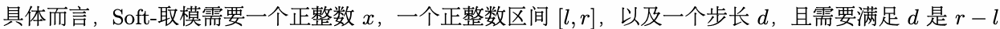

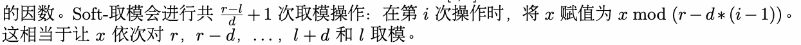

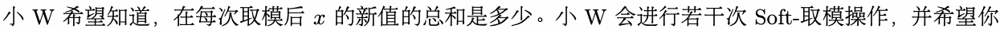

可以对每次 Soft-取模操作求出对x应的总和。

## Input

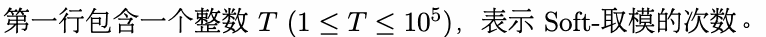

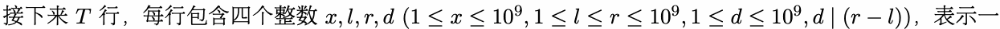

次 Soft-T取模操作。

## Output

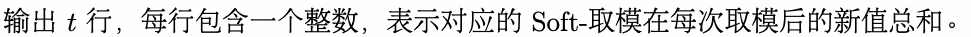

## Example

### 样例输入

```text
3
7 1 5 2
1919810 114 514 10
749999999 1 500000000 1
```

### 样例输出

```text
4
820
62499999999999999
```

## Note

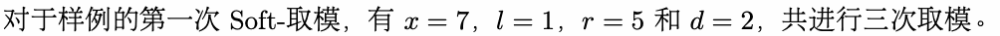

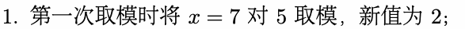

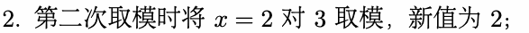

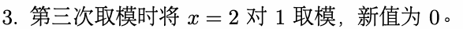

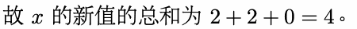
