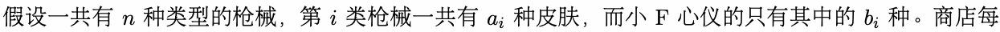
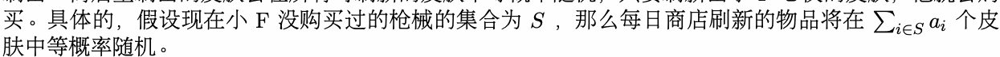
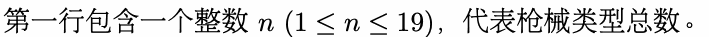
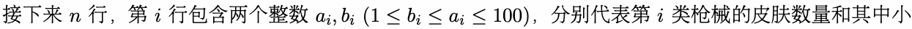
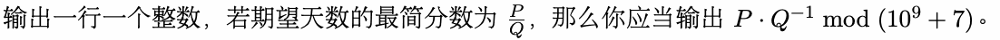

# F. 商店

输入文件： standard input
出文件：

输出文件： s s t t a a n n d d a a r r d d i o n u p t u p t ut
时间限制： 1 second

时间限制： s1tsaencdoanrdd

空间限制： 256 megabytes

小 F 最近沉迷某款四字游戏，每天早上八点醒来第一件事就是打开每日商店看看是否刷出心仪的皮肤。

他的好兄弟 ZZ 看他刷不出金整天愁眉不展，打算帮助他写个程序预测一下。



天只刷新一种n皮肤，且如果小 F 购i买过某类枪械的a皮i 肤，那么这类枪械的所有皮肤将不会b再i 次在商店里




现在 ZZ 想让你帮忙写个程序预测小 F 期望需要多少天才能为每类枪械购买一件皮肤。

## Input





F 心仪的n皮肤数量i。

## Output



## Examples

### 样例输入

```text
3
3 1
3 1
3 1
```

### 样例输出

```text
9
```

### 样例输入

```text
19
65 27
55 3
32 14
59 1
75 71
96 84
69 49
68 59
98 73
85 73
20 3
14 13
75 62
86 46
35 10
40 20
13 3
25 12
85 48
```

### 样例输出

```text
2374748
```
