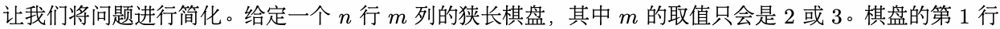
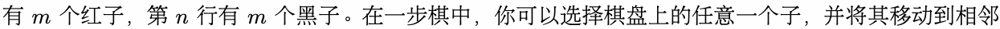
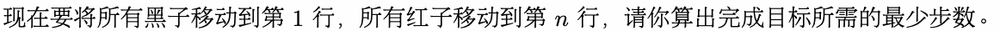
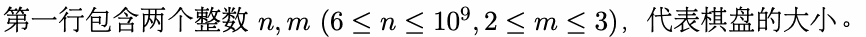

# G. 过河卒

输入文件： standard input
出文件：

输出文件： s s t t a a n n d d a a r r d d i o n u p t u p t ut
时间限制： 1 second

时间限制： s1tsaencdoanrdd

空间限制： 256 megabytes

棋盘上有黑红两方的过河卒，需要走到底线。过河卒行走的规则是可以向左移动一格，向右移动一格或

者向前移动一格。然而，这一题没有对方的棋子拦截你的过河卒，双方需要做的反而是配合让所有过河

卒走到底线。





且没m有子的位置上n。两个位m置相邻，当且仅当二者在同一行且列数差恰好为 1，或者二者在同一列且行
数差 为 。

数差恰好为 1。



## Input



## Output

输出一行一个整数，代表答案。

## Examples

### 样例输入

```text
6 2
```

### 样例输出

```text
22
```

### 样例输入

```text
6 3
```

### 样例输出

```text
34
```
