# H. 三仙归洞

输入文件： standard input
出文件：

输出文件： s s t t a a n n d d a a r r d d i o n u p t u p t ut
时间限制： 3 seconds

时间限制： s3tsaencdoanrdds

空间限制： 512 megabytes

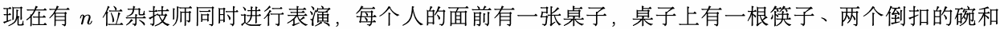

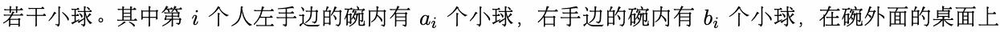

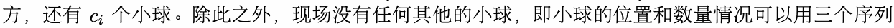

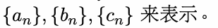

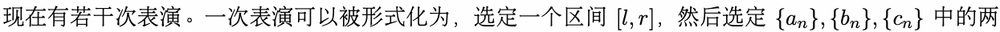

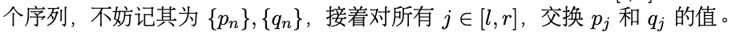

作为这场表演的观众，你因为拥有透视功能，且观察相当细致，所以知道了以上的所有信息。出于好

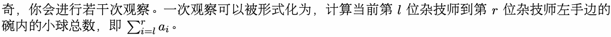

由于杂技师的数量众多，于是你决定用计算机编写一个程序来帮助你解答这个问题。为了方便表述，我

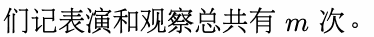

## Input

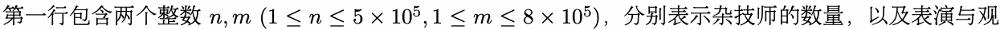

察的总次数。

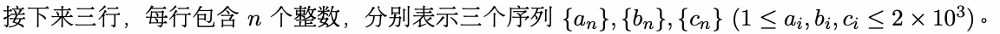

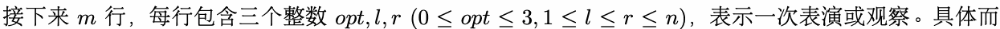

言：

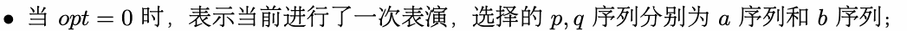

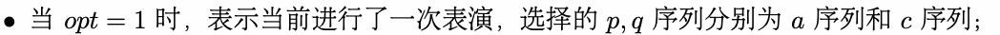

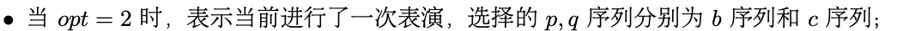

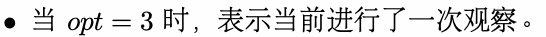

## Output

对于每次观察，输出一行一个整数，表示这次观察的计算结果。

## Example

### 样例输入

```text
8 10
486 249 12 175 432 1074 1054 677
1325 159 941 1090 486 1324 989 1208
331 801 1232 930 1004 179 1073 99
3 5 7
2 5 6
1 4 5
2 7 8
3 5 8
1 5 7
0 2 8
2 2 5
0 3 5
3 1 8
```

### 样例输出

```text
2560
3291
3889
```

## Note

本题输入数据量较大，请使用较快的输入方式。
