# I. 挑选座位

输入文件： standard input
出文件：

输出文件： s s t t a a n n d d a a r r d d i o n u p t u p t ut
时间限制： 2 seconds

时间限制： s2tsaencdoanrdds

空间限制： 256 megabytes

中午下课的时候，松韬园里总是有很多人，小 Z 一般会挑选一个周围的人尽量少的座位入座。但松韬园

很大，小 Z 有时候不能在短时间里找到合适的座位，所以他决定统计每个座位周围的人数。

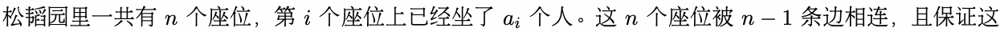

些座位可以互相到n达。两个座位i是相邻的，当且仅当a这i 两个座位被n 一条边相连n。−一1 个座位周围的人数被

定义为这个座位的人数和与这个座位相邻的所有座位的人数之和。

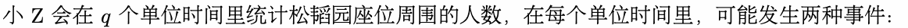

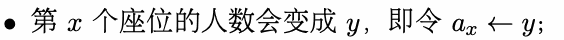

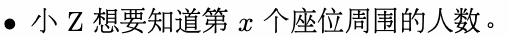

小 Z 希望你能帮他解决这个问题。

## Input

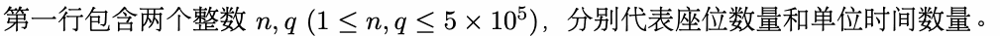

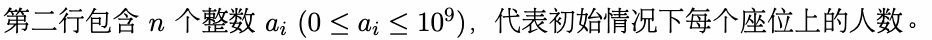

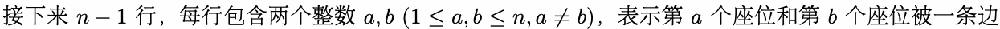

相连。

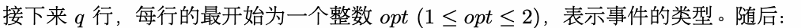

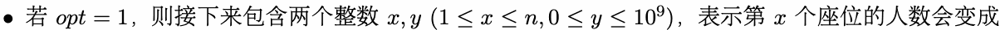

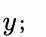

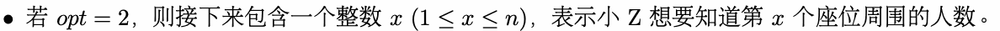

## Output

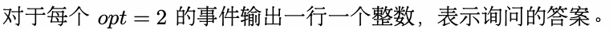

## Example

### 样例输入

```text
5 3
1 2 3 4 5
1 2
2 3
2 4
4 5
2 2
1 2 3
2 2
```

### 样例输出

```text
10
11
```

## Note

本题输入数据量较大，请使用较快的输入方式。
