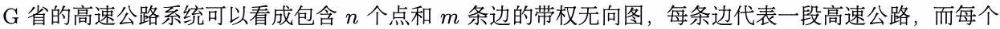
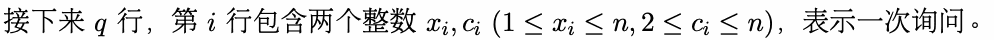

# J. 高速公路

输入文件： standard input
出文件：

输出文件： s s t t a a n n d d a a r r d d i o n u p t u p t ut
时间限制： 3 seconds

时间限制： s3tsaencdoanrdds

空间限制： 512 megabytes




现在小 Z 正在 G 省通勤，小 Z 的车每行驶一公里消耗一单位的油。任意一个城市中存在加油站可以把


## Input


量。




## Output


## Example

### 样例输入

```text
5 7
3 5 13
1 2 8
1 4 6
5 1 9
1 2 8
3 4 2
5 1 15
5
3 2
5 2
4 3
2 4
2 5
```

### 样例输出

```text
2
9
6
8
9
```

## Note

本题输入数据量较大，请使用较快的输入方式。
