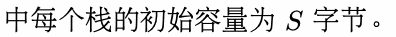
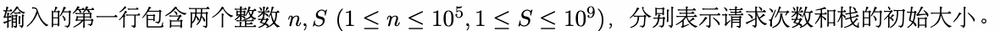
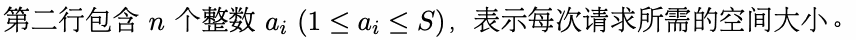
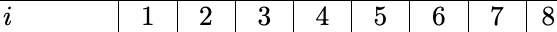
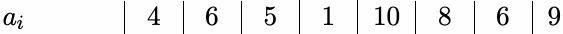

# K. 分配系统

输入文件： standard input
出文件：

输出文件： s s t t a a n n d d a a r r d d i o n u p t u p t ut
时间限制： 1 second

时间限制： s1tsaencdoanrdd

空间限制： 256 megabytes

小 T 在学习操作系统原理后心血来潮，想要自己实现一个分配系统。这个分配系统由若干个栈组成，其




间。如果这个分配系统在中途出现空间不够的情况，则认为任务失败，否则任务成功。

小 T 想要知道，在所有的栈初始均为空的情况下，为了完成任务，至少需要使用多少个栈？

## Input





## Output

输出一行一个整数，表示最少所需的栈数量。

## Example

### 样例输入

```text
8 20
4 6 5 1 10 8 6 9
```

### 样例输出

```text
4
```

## Note

对样例数据，以下是在使用三个栈时对应的分配信息：





第一个栈ai的大小
2
4
0 1
6
6 1
5
6 1
1
6
1
1
0
5
8
5
6
5
9
5
二个栈的

第二个栈的大小 2 2 0 0 1 2 6 0 1 1 6 4 1 1 6 4 1 1 5 4 1 5 4 1 5 4 5 8
三个栈的

第三个栈的大小 2 2 0 0 2 2 0 0 1 2 4 0 1 1 4 5 1 1 4 5 1 1 4 5 1 7 4 8 7

可以发现在最后一次分配时，所有栈均没有足够的容量，故使用三个栈时无法完成任务。
