# L. 提前修改

输入文件： standard input
出文件：

输出文件： s s t t a a n n d d a a r r d d i o n u p t u p t ut
时间限制： 1 second

时间限制： s1tsaencdoanrdd

空间限制： 256 megabytes

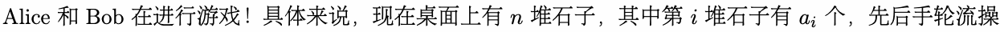

作，每次操作者需要选择一堆非空的石子，并拿走至n少一颗石子，取完最i 后一颗石a子i 的玩家取得胜利。

由于 Alice 和 Bob 都是绝顶聪明的，所以他们总会采用最优策略进行游戏。

喜欢研究博弈论的你当然知道，这是典型的 Nim 游戏，当双方均采用最优策略时，先手在

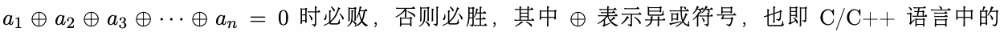

x
a
o
1
r
⊕运a2算⊕符a。3 只⊕通··过· ⊕一a点n 计=算0，你就预测出了最后的结果，⊕于是你决定在游戏进行前，尝试对当前局面
做 作。

x做o操r 作。

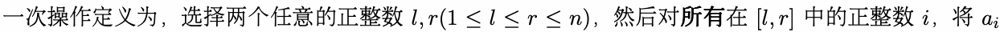

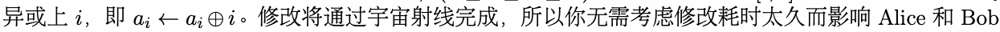

的游戏进i 行。a

你想要知道，是否存在有限次操作的方案，使得局面能够转变为先手必败态。由于你追求完美，所以更

进一步地，如果存在这样的操作方案，你还希望所需的操作次数能够最小化。你决定写一个程序来解答

这个问题。

## Input

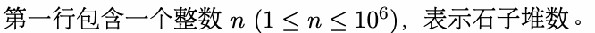

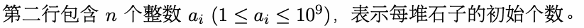

## Output

若不存在有限次的操作方案，使得局面能够转为先手必败态，则输出 -1。

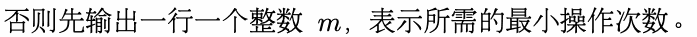

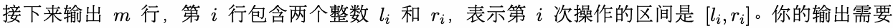

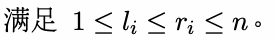

如果存在多种操作次数最小的合法方案，输出任意一种即可。

## Examples

### 样例输入

```text
5
20 24 8 7 2
```

### 样例输出

```text
1
4 5
```

### 样例输入

```text
8
21 52 11 25 41 67 77 10
```

### 样例输出

```text
-1
```

## Note

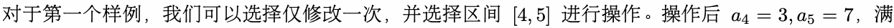

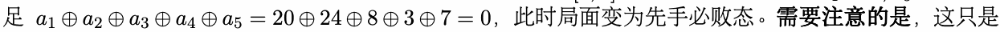

其中a一1 ⊕种a最2 ⊕优a方3 ⊕案a，4 ⊕即a使5 你=的20答⊕案24和⊕样8例⊕输3 ⊕出7不=同0，只要你的答案是任意一种最优方案，你的答案都会

被判定为正确。
