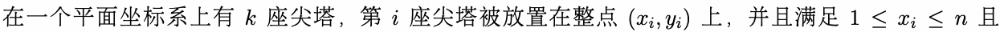
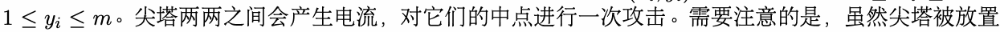
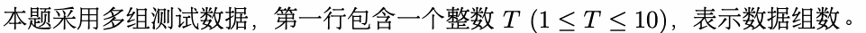
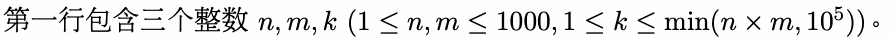
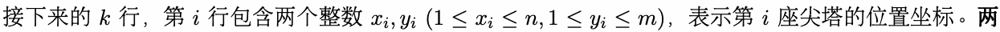
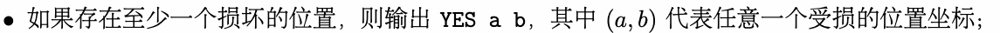
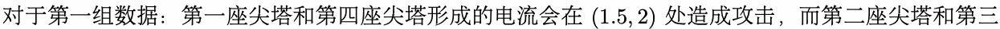
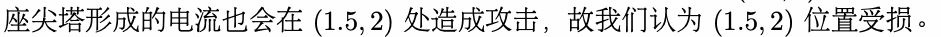

# M. 尖塔攻击

输入文件： standard input
出文件：

输出文件： s s t t a a n n d d a a r r d d i o n u p t u p t ut
时间限制： 1 second

时间限制： s1tsaencdoanrdd

空间限制： 256 megabytes





1在≤整y点i 上≤ ，m但其中点并不一定落在整点上，此时的攻击依然是生效的。

如果一个位置被攻击了至少两次，那么这个位置就会被损坏。你需要检查是否存在受损的位置，如果

有，还需要给出其中任意一个位置的坐标。

## Input



在每组数据中：





座尖塔的位k 置可能相i 同，此时它们的中xi点,y视i (为1 ≤尖x塔i 所≤在n,的1 ≤位置yi 。≤

## Output

对于每组数据，输出一行：



- 否则，输出 NO。

## Example

### 样例输入

```text
2
3 3 4
1 1
1 2
2 2
2 3
5 5 7
1 5
2 3
1 1
1 3
1 2
5 1
3 3
```

### 样例输出

```text
YES 1.5 2.0
NO
```

## Note




