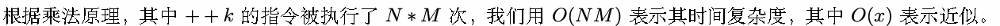
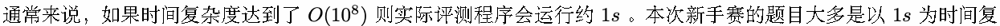
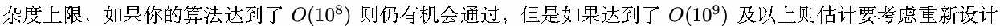
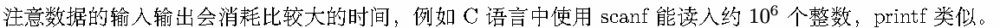
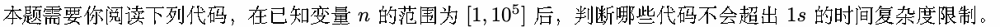

# A. 关于时间复杂度

Time limit: 1 second

Memory limit: 256 megabytes

在比赛中你可能会遇见复杂度上的问题，例如一个算法程序运行时间过长，所以在实现算法前，我们会估算算法的

时间复杂度。

关于复杂度，前人有很丰富的理论，这里我们只用最简洁的方式介绍时间复杂度。同一个算法在不同的计算机上运

行的速度会有一定的差别，并且实际运行速度难以在理论上进行计算，实际去测量又比较麻烦，所以我们通常考虑

的不是算法运行的实际用时，而是算法运行所需要进行的基本操作的数量。

影响时间复杂度的最主要因素是循环，我们通常可以通过估算指令循环进行的次数来得到一种时间复杂度。如以下

程序

1 int k=0;

2 for ( int i =0;i<N;++i )

3 for ( int j =0;j<M;++j )

4 ++k;

算法或者改善常数部分了。

C++ 的 cin/cout 与 Python 的 input/print 开销会更大，所以如果这些方法输入可能会超时，则请转用 C 语言的

scanf 输入。

## Input

本题没有输入数据。

1 //此代码编号为 A

2 int k=0;

3 for ( int i =1;i<n;++i )

4 for ( int j=i +1;j<=n;++j )

5 ++k;

1 //此代码编号为 B

2 int k=0;

3 for ( int i =1;i<n;++i )

4 for ( int j =1; j∗j<=n;++j )

5 ++k;

1 //此代码编号为 C

2 int k=0;

3 for ( int i =1;i<n−1;++i )

4 for ( int j =1; i ∗j<=n;++j )

5 ++k;

1 //此代码编号为 D

2 for ( int i =1;i<n;++i ) {

3 int j=i ;

4 while ( j >0) {

5 if ( j%2==0)

6 j=j /2;

7 else

8 j −=1;

9 }

10 }

## Output

你的程序需要输出一行字符串，按编号顺序升序输出不会超时的代码的编号。

例如如果你认为编号 A,B,D 不会超时，则输出

1 ABD

其中编号为大写字母，编号间没有用来间隔的字符，字符串前后没有空格。
