# B. 老实点 每次都有你

Time limit: 1 second

Memory limit: 256 megabytes

众所周知，Xcw 是 pcr 中的人气角色（Xcw：骑士君哥哥可以再叫我一次镜华吗），同时她也受 Lanly 委托，来到

新手赛咨询群中处理事务。

Lanly 不总是有时间教 Xcw 做更多的事——这也给了群友们时不时整出些让人两眼一黑的活的机会——Lanly 不

仅忙于自己的工作，还要抽出时间到 pcr 中刷装备。

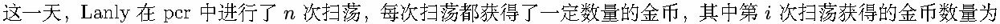

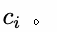

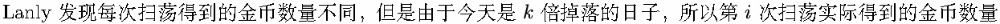

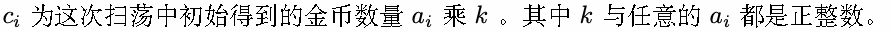

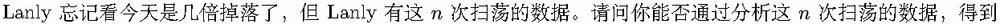

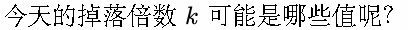

## Input

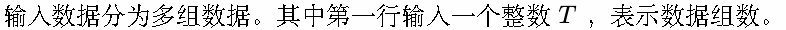

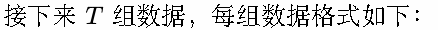

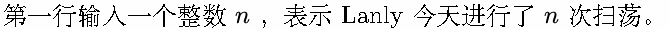

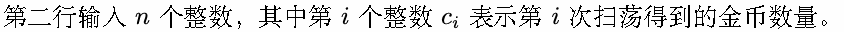

## Output

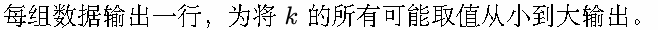

## Example

### 样例输入

```text
3
6
6 27 30 18 39 9
7
8 36 32 20 36 52 12
6
14 56 42 28 49 21
```

### 样例输出

```text
1 3
1 2 4
1 7
```

## Note

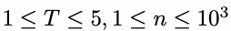

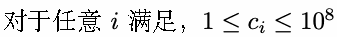

提示：存在与开方相关复杂度的求因数算法。
