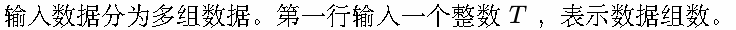
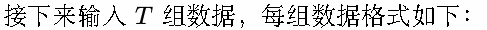
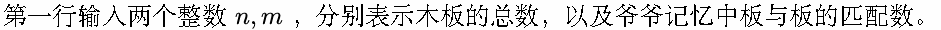
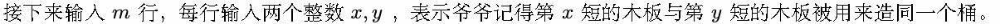
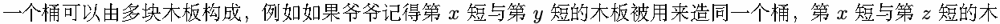
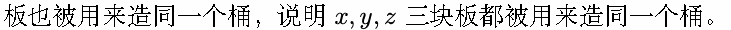
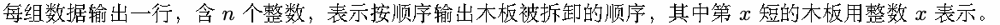
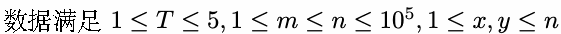

# C. 木桶效应

Time limit: 1 second

Memory limit: 256 megabytes

爷爷说：“你和我去把那几只破木桶拆下来吧。“

杂物房角落的破木桶，我仍有印象，记得木桶的形状是不太规则的，听说用来造这几只木桶的每块板的高度都不一

致，所以也没有太能派上用场。小时候许多承载了珍贵回忆的小物件被堆积在那几只破木桶里，兴许已经蒙上了厚

厚的尘。

爷爷说：“木桶的拆除要从板的角度拆，一个桶先拆下最长的那块板，然后拆第二长的，这样子去拆，最省力。然

后木桶要一个一个去拆，因为你还要收拾桶里的东西，收拾好一个就给我拆一个。对了，你先去收拾东西最少的那

桶，加快速度。“

东西最少？我怎么会记得哪桶里放的多少东西呢？

爷爷说：“木桶效应，还记得吧？我记得你小时候我就是指着这几只桶和你讲的木桶效应，一只桶能装多少，取决

于桶的最短板。短板最短的桶，就是东西最少的桶。“

好吧，也许是这样的。我开始翻箱倒柜找卷尺准备量木板的长度。

爷爷开始说：“额，我记得，好像当初造的时候，最短的那块板好像是和第二长的那块板在一起的，造同一个桶......

是第二长吗？额......“

我来兴趣了，如果木桶的构成真如爷爷的记忆的一致，那么到最后，各块木板会按怎样的顺序被拆下来呢？

## Input













当然有许多块木板没有被爷爷提及，那么我们不妨假设这些木板单块木板就能构成一个木桶。

## Output



木板的拆卸简单来讲就是找到未被拆下的最短木板所在的木桶，将此木桶最长的木板拆下，以此类推直到全部拆

完。

## Example

### 样例输入

```text
3
10 5
3 2
2 7
4 2
5 9
1 5
10 8
7 2
1 10
2 3
2 8
3 9
1 2
5 1
4 1
10 5
7 10
8 7
7 9
1 6
3 7
```

### 样例输出

```text
9 5 1 7 4 3 2 6 8 10
10 9 8 7 5 4 3 2 1 6
6 1 2 10 9 8 7 3 4 5
```

## Note


