# D. 究极手

Time limit: 1 second

Memory limit: 256 megabytes

《塞尔达传说：王国之泪》将会在 2023.05.12 发售，Windberu 表示这个 4 月份是一天也呆不下去了。

前阵子，Windberu 看见了《王国之泪》的实机演示视频，激动无比，对其中林克的各项新能力非常感兴趣。

其中林克获得的一项能力是「究极手」，它让林克能够将许多材料连接拼装成一个整体，只需要敲击这个整体的任

意一个位置，就会有一个信号被传递，启动连接在这个整体里的风扇机。如下图展示的这样

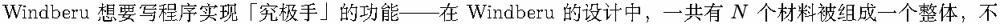

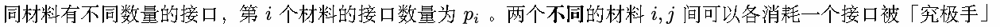

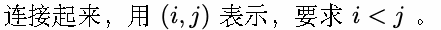

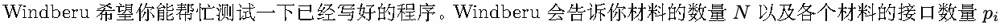

，希望你给 Windberu 一个使用「究极手」连接材料的测试数据，测试数据含使用「究极手」的次数以及分别在哪

两个材料间使用。要求所有材料到最后都被连接起来成为一个整体，且每个材料的所有接口都被用上。

但是 Windberu 在尝试实现信号传递的功能时发现程序卡住了，检查后发现当材料的连接结构出现环的时候会出问


Windberu 发现自己修不好这个 bug ，于是反其道而行之，Windberu 要求你给的测试数据里不能出现这样的结构。

得知这样的奇怪要求的你依然愿意给 Windberu 测试数据，但是你也降下神罚，惩戒 Windberu 明年才能玩到《王

国之泪》。

## Input

输入数据包含多个数据点，每个数据点格式如下

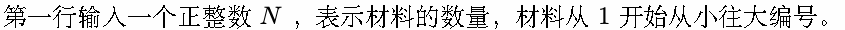

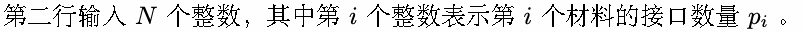

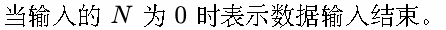


## Output

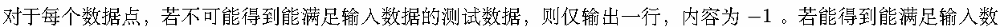

据的测试数据，则输出测试数据。如果包含多个能满足的测试数据，输出任意一个即可。其中测试数据的格式为

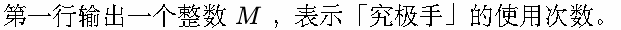

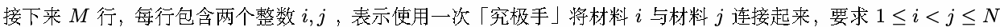

，可以按任意顺序输出。要求所有材料到最后都被连接起来成为一个整体，且每个材料的所有接口都被用上，且不

能出现环结构。

## Example

### 样例输入

```text
3
2 2 2
6
1 1 4 1 2 1
13
1 9 1 1 3 2 1 1 1 1 1 1 1
6
1 1 1 1 1 5
2
1 1
0
```

### 样例输出

```text
-1
5
5 6
3 5
3 4
2 3
1 3
12
6 13
5 6
5 12
2 5
2 11
2 10
2 9
2 8
2 7
2 4
2 3
1 2
5
5 6
4 6
3 6
2 6
1 6
1
1 2
```

## Note

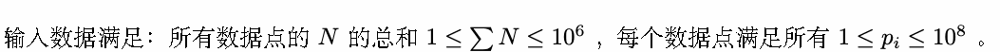

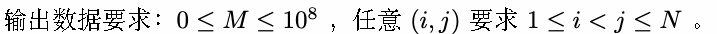

（PS：事实上 Windberu 买不起 Nintendo Switch ，所以即使《王国之泪》发售也玩不到《王国之泪》）
