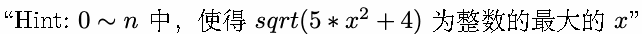
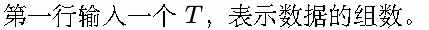
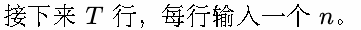
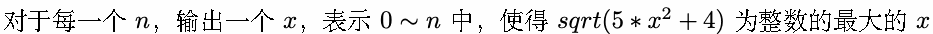
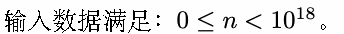

# E. Password

Time limit: 1 second

Memory limit: 256 megabytes

— H002 Observation Record #78 —

最后一个人类死去了。

按照人类的习俗，我开始整理你的遗物。

你的物品总是很整洁，似乎总是那几件衬衫，以及有些旧了的白大褂。每当我问起时，“真理总是很简洁哦。”，你

会微敛双眸，这样淡淡地回答道。

“什么是真理呀？”

“存在没有意义。很简洁吧？”

人类最后的科学家，那个永远站在宇宙的尽头，用冷冰冰的真理藐视一切荒谬的研究者，现在却给系统上了密码。



我皱起了眉头，好复杂，一点也不像你。

所以，其实这一道题的答案，也一定很简洁吧？这样想着，我输入了密码。

## Input





## Output



## Example

### 样例输入

```text
4
12
4
2
0
```

### 样例输出

```text
8
3
1
0
```

## Note



好想知道，这样的你，也会有在乎的事情吗？

让我来看一看吧。

— EOF —

WARNING：偏执或错误的人类思想

本记录中蕴含的思想可能偏执或错误，任何分析者不应认同或模仿其中的观点，并严格遵循《人类档案分析规范》。
