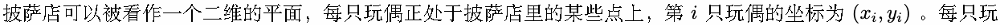
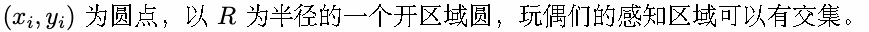
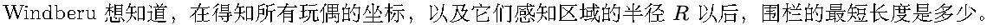
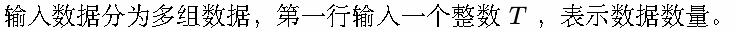
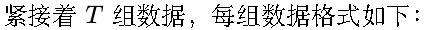
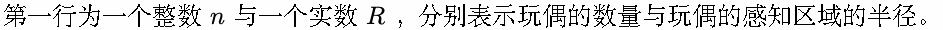
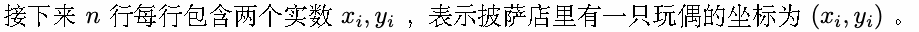
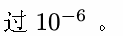
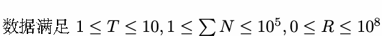
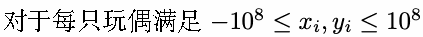

# F. 熊爷别笑了

Time limit: 1 second

Memory limit: 256 megabytes

FNaF 是 Windberu 非常喜欢的游戏之一，但 Windberu 在多数时间里是云玩家，因为玩偶们的 Jump Scare 实在

让人心脏受不了。

终于有一天，Windberu 试图自己上手玩 FNaF 的时候被 Freddy 吓得心脏停跳半拍，于是 Windberu 忍不了了，

恨不得自己跳进披萨店里建个围栏把玩偶们围起来。



偶都具有对身体四周的感知能力，由于玩偶们是同一批一起生产的，所以它们能感知到的区域统一为以自身坐标



Windberu 需要将玩偶们围起来，不过 Windberu 清楚，要是围围栏过程中稍有不慎就得接受玩偶的 Jump Scare 。

因此围栏需要满足以下要求：

- 围栏要将所有玩偶围进密闭的区域里。即从玩偶的坐标出发，不存在路径使其能不跨过围栏到达无穷远。

- 围栏要确保所有玩偶是连通的。即对于任意两只玩偶，存在一条路径不跨过围栏连接两只玩偶的坐标。

- 围栏过程要确保不进入玩偶的感知区域。即不存在围栏上的点在任一玩偶的感知区域内。

- 在满足以上要求前提下，要求围栏长度尽可能短短。不然围栏不及时是会遇上 Jump Scare 的。



## Input









## Output

每组数据输出一行，含一个实数，表示将玩偶按题目要求围起来后，围栏的最小长度，要求与最终答案精度差不超



## Example

### 样例输入

```text
2
4 0.7
1 1
-1 1
-1 -1
1 -1
3 0.0
1 0
0 1
0 -1
```

### 样例输出

```text
12.39822971502571
4.82842712474619
```

## Note




