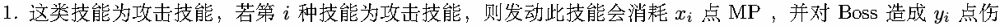
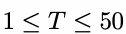
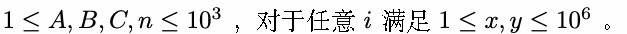

# H. Pause! Heal! Explosion!

Time limit: 1 second

Memory limit: 256 megabytes

由于你博学，审问，慎思，明辨，笃行，并且常年在咨询群里调戏 Xcw ，所以 Xcw 开着电子大卡车将你送到了异

世界当龙/凤傲天。

这是由 Hitass\_SY 创造的剑与魔法的异世界，这个设定完备的异世界要游戏性有游戏性，要美术有游戏性，要剧

情有游戏性，要音乐有游戏性。你非常喜欢这个世界，并且选择转职成为一位大魔法师。

这一天，你在单刷副本时遇见了一位凶恶的 Boss ，与其展开了激烈的战斗。战斗为回合制，每回合由你进入行动


当你在 Boss 的攻击下 HP 小于等于 0 的时候，你就会被判定为战斗失败。

你装备的 Xcw 赠送的精力戒指使得每回合轮到你的行动轮的时候，你会自动回复 1 点 MP ，随后你可以使用现有

的 MP 释放技能与 Boss 战斗。


被分为三类:



害。


含本回合)，使其在其行动轮中不能发动攻击。


每回合你的行动轮中你能释放技能，但是不能预支 MP ，即释放技能后 MP 不能小于 0 。当你使用攻击魔法将

Boss 的血量削减至小于等于 0 则被判定为胜利。

由于你接下来还有其它区域需要探索，你希望战胜 Boss 后你剩余的 HP 尽可能多——你不怎么在意 MP 会剩下多

少。你想知道你是否能击败 Boss ，以及如果你击败了 Boss 被判定为胜利时，你能剩余 HP 最大为多少。

## Input


## Output

每组数据仅输出一行，表示你击败 Boss 时能剩下的最大 HP 。

若你不能击败 Boss 则输出

1 0

若你能在击败 Boss 前使 HP 趋于无穷大，则输出

1 inf

## Example

### 样例输入

```text
3
10 2 9 3
1 1 1
2 3 4
1 3 5
7 3 9 3
1 1 1
3 7 9
1 3 5
6 2 9 3
1 1 1
3 1 3
1 3 5
```

### 样例输出

```text
5
0
inf
```

## Note





你发现由于 Hitass\_SY 由于空闲时间缺乏，选择专攻异世界的游戏性，把异世界的美术、音乐交给了 Windberu

实现。而 Windberu 很懒，总是摸鱼，赶 DDL 完成了自己的工作，导致效果很差。可是你感到奇怪，为什么艺术

性如此糟糕的异世界还能吸引那么多人转生到来呢？

哦，原来是异世界原住民每天都通过照片与影像做日记记录生活，而 Xcw 神教导人民用广州光锥元信息科技有限

公司的产品，完善照片与影像对异世界美好生活的重现效果，使这些日记上传到社交平台后异世界饱受好评。

广州光锥元信息科技有限公司是一家面向海外市场的互联网公司，致力于用前沿技术和创意设计，打造世界领先的

视频、图像创作 APP，风很大的 Oldroll、Proccd、PrettyUp、UnidreamAI 绘画等 APP 就是我们的作品！目前我

们正在快速发展，全球用户超过 3 亿，多款 APP 在欧美、东南亚等地的应用市场摄影视频榜单排行前列。

我们提供有竞争力的薪酬福利、开放年轻的工作氛围、快速成长的职业机会。我们有良好的应届生文化和完善的新

人培养机制，在这里同学们将有机会由浅入深，快速学习成长，我司也有很多中大毕业的学长学姐，和我们成长为

独当一面的大牛，详情请戳官网 https://www.guangzhuiyuan.com/job.html
