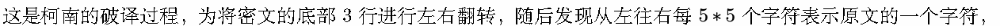
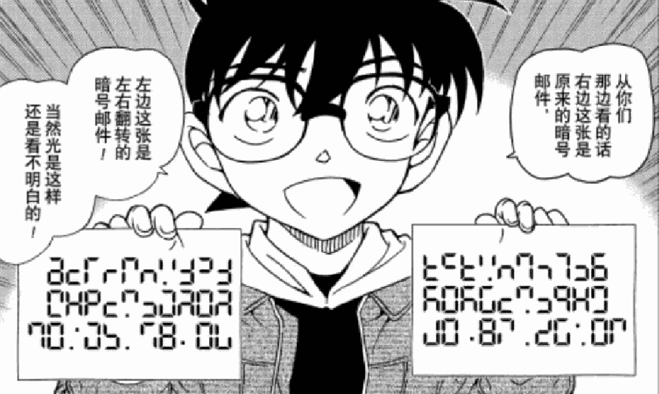
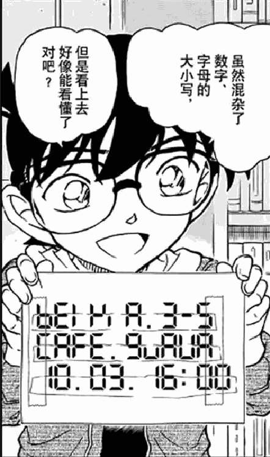
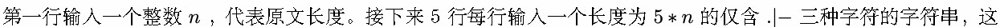
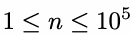

# I. 小学生也能秒解的题

Time limit: 1 second

Memory limit: 256 megabytes

Lanly 告知 Windberu ，在《名侦探柯南》的动画第 1135 集（对应漫画的第 1062 话）中，柯南在诸多 FBI 面前

淡定地破解了暗号，令众人佩服。



借此破译出了原文的各个字符。

现在 Windberu 也给你一段密文，告诉你原文仅含小写字母，希望你能帮忙破译得到原文。





## Input



5 行字符串代表着加密后的文字。

## Output


## Example

### 样例输入

```text
9
............-.........-....-....-...-.-..-.-.
.|....|....|.|..|.|..|....|.|..|...|.|.||.|.|
.................-....-......................
|.|.||.|.|...|..|.|....|..|.|..|.|....|....|.
............-.........-....-....-....-.......
```

### 样例输出

```text
iloveacmm
```

## Note



你可能需要依靠随题目提供的大数据完成本题。
