# J. Abyssal Echoes

Time limit: 1 second

Memory limit: 256 megabytes

我们并排坐在深深的海底，看着波澜的海浪把阳光

切碎。

—佚名

你醒来，丝缕光线透过沉沉的海水，游曳在你和她的身边。

迷茫地起身，一只章鱼惊慌地从她的手上跃起，舞动着长长的腕足，消失在了深海里。“啊！真是的... 你把它吓跑

了... ” 她直勾勾地盯着你，落寞地说，“我们在聊很重要的事情呢”。

什么呀，这样的，“我听到了哦，是在说我的坏话吧。”

一瞬，偌大的海床只剩下了深海的回响。终于，她抿着唇，咯咯地笑起来，“你又不知道它的频率，你怎么知道呢？”


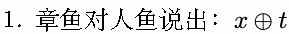

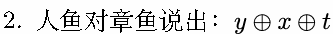

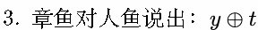

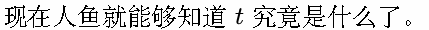

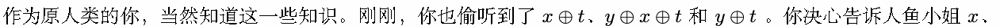

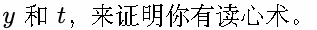

但是，你已经很久很久没有算过数了。“你能帮我算一算吗？” 你对着趴在肩上的小海星问道。

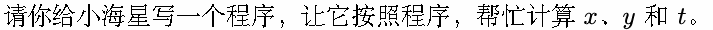

## Input

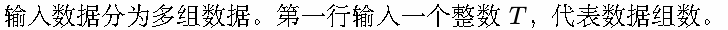

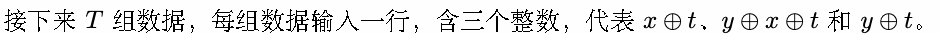

## Output

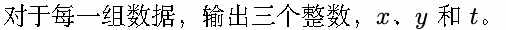

## Example

### 样例输入

```text
3
203 0 79
135 0 22
15 0 115
```

### 样例输出

```text
79 203 132
22 135 145
115 15 124
```

## Note

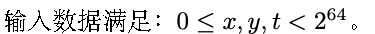

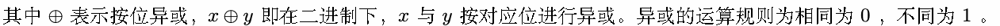

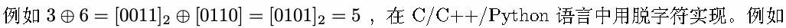

1 a^b

注意，由于数据较大，你需要使用 unsigned long long。在 linux 下使用 C 语言的你需要使用%llu 输入整数：

1 unsigned long long a ;

2 scanf (”%llu ” , &a) ;
