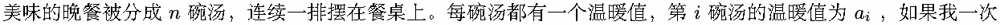
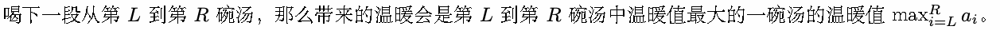
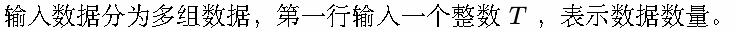
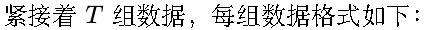
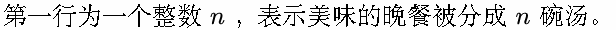
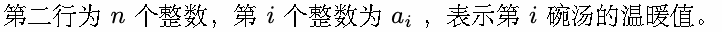
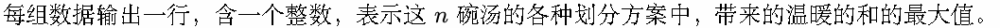
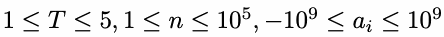
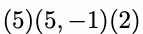
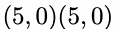

# K. 晚餐铃

Time limit: 1 second

Memory limit: 256 megabytes

晚餐铃响起，像梦里那样呼唤着我。

因为不能选择，所以才不情愿地称之为爱吗？长围裙也是有温度的人。

无论什么时候我都会乖乖的，从前妈妈定下的规矩，某个寒夜里在路边弄丢了，打不开的门的剪影、白铃铛。

我不想吃的东西数也数不完，但如果一直这样的话我会慢慢死去，变得渺小而悲惨。喝下玩具厨师煮的热汤，用那

份温暖熬到天亮。抱紧自己好好睡一觉吧。





一段一段地喝完所有的汤，每段都会给我带来温暖，这些温暖加起来会是无比幸福的吧？我可以将汤分成任意段，

每段为连续的任意长度，该怎样划分，使得最后带来的温暖的和最大呢？

像世俗那般，和大家一样，治好我的发烧吧，温柔地治好我吧，晚餐铃。


## Input









## Output



## Example

### 样例输入

```text
4
4
7 2 2 5
4
7 5 3 1
4
5 5 -1 2
4
5 0 5 0
```

### 样例输出

```text
16
16
12
10
```

## Note



样例后两组数据的合适的划分方法分别为




