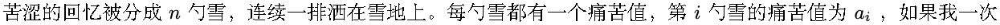
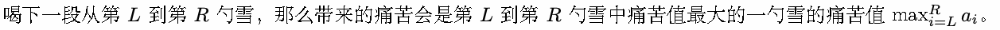
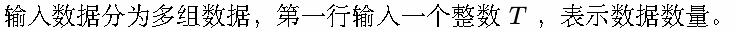
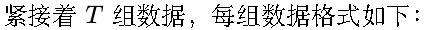
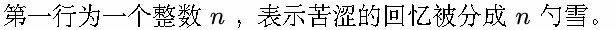
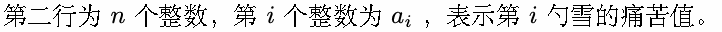
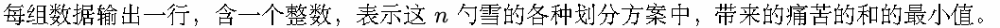
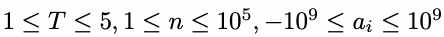
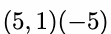
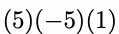

# L. 晚餐铃

Time limit: 1 second

Memory limit: 256 megabytes

晚餐铃响起，像寻常那样呼唤着大家。

各种我所不拥有的东西散落一地，大家理所当然拿着的餐具，触碰就消失不见了。

在梦里我能飞翔，用以前魔女给的翅膀，回家路上透过窗口看到的温暖聚会，长围裙的剪影、白铃铛。

我没有的东西数也数不完，回家路上透过窗口看到的温暖聚会，在魔术光里的喧闹。每次每次看到他们我都忍不住

想，那份温暖是怎么来的由什么组成的？那里的孩子知道答案是什么。





一段一段地喝完所有的雪，每段都会给我带来痛苦，这些痛苦加起来会是难以承受的吧？我可以将雪分成任意段，

每段为连续的任意长度，该怎样划分，使得最后带来的痛苦的和最小呢？

被银雪覆盖着，在我的心脏变冷之前，呼唤我的名字吧，晚餐铃。


## Input









## Output



## Example

### 样例输入

```text
3
3
5 1 -5
3
5 -5 1
4
5 -7 3 -2
```

### 样例输出

```text
0
1
-1
```

## Note



样例前两组数据的合适的划分方法分别为




