# M. 梦与公交站

Time limit: 1 second

Memory limit: 256 megabytes

小 Zo 正在公交站等车，可是深夜里公交车已经不会再来了。在小 Zo 开始哭泣之前，空中出现了一位小精灵。小

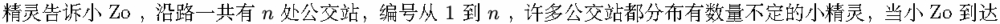

一处公交站的时候，该公交站的小精灵会用传送魔法帮助小 Zo 到想去的公交站。

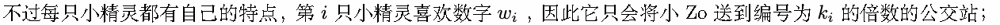


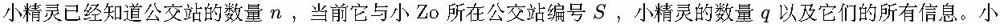

精灵想要知道，将小 Zo 送去某一个公交站，最短需要多长时间。

## Input

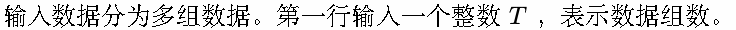

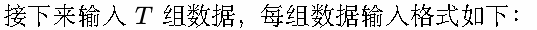

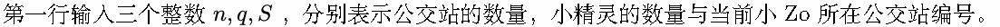


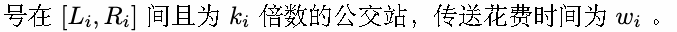

## Output

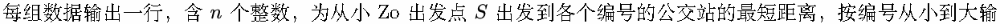

出。

## Example

### 样例输入

```text
3
5 5 1
1 1 4 1 13
1 2 5 2 3
2 3 5 1 9
4 2 3 1 5
5 1 5 1 1
5 5 1
1 1 3 2 1
2 1 3 1 2
3 3 5 5 1
2 2 4 2 3
5 1 5 1 1
4 3 3
1 1 4 1 7
3 1 3 1 2
2 2 4 2 4
```

### 样例输出

```text
0 3 8 3 12
0 1 3 4 4
2 2 0 6
```

## Note

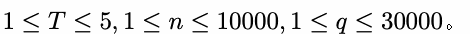

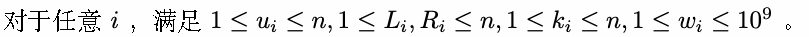

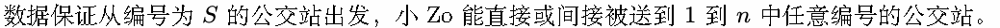
