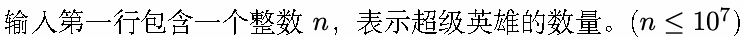
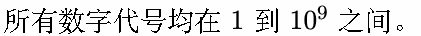
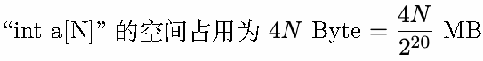

# F. 绝对霸主

输入文件: standard input

输出文件: standard output

时间限制: 3 seconds

空间限制: 4 megabytes

在 SYSU 举办百年校庆的喜庆氛围中，一场悄无声息的数字之争悄然展开！SYSU 的校友们化身为超级

英雄，每个人都有一个数字代号。数字代号聚集在一起，组成了一支强大的数字联盟。但是，传闻中有一

个数字代号出现的频率超过了其他所有代号的出现频率之和，成为了数字联盟中的绝对霸主！

作为 SYSU 聪明绝顶的数字学家，你的任务是揭示这个数字联盟的绝对霸主！

## Input






## Output

输出一个数字，表示绝对霸主的数字代号。

## Examples

### 样例输入

```text
6
10 10 10 10 10 10
```

### 样例输出

```text
10
```

### 样例输入

```text
5
8 8 4 8 3
```

### 样例输出

```text
8
```

## Note


