# I. 第三心脏

输入文件: standard input

输出文件: standard output

时间限制: 1 second

空间限制: 256 megabytes

每当一起回家时

分离以后脆弱的我冒出想法

没有和你道别是因为

不想你一个人被寂寞和黑暗吞噬

那颗冰冷的第三心脏

一直默默地在看着我们两人

—第三心脏

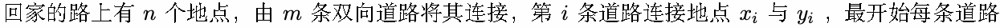

都是黑暗的，你需要选择任意条 不相交 (任意两条路径没有重复地点) 的 路径，将上面所有的道路点亮，

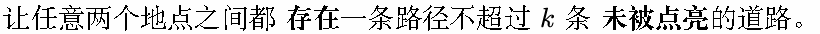

对于任意两个地点，保证可以通过双向道路连接。

路径：无重复节点的节点序列，相邻节点存在一条双向道路将它们相连。

## Input

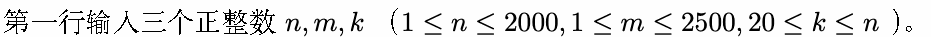

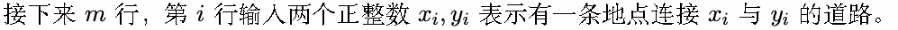

不存在任意两条道路连接的地点完全相同，不存在道路两端连接同一个节点，对于任意两个地点，保证可

以通过双向道路连接。


## Output

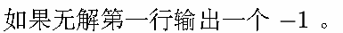

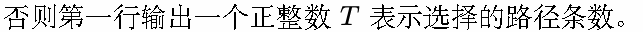

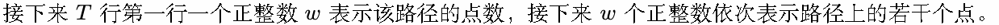

如题，你需要保证没有输出重复的点。

## Example

### 样例输入

```text
9 12 20
1 2
1 9
2 3
2 6
2 7
3 4
4 5
4 8
4 9
5 6
6 7
6 8
```

### 样例输出

```text
2
5 5 4 8 6 7
4 3 2 1 9
```

## Note

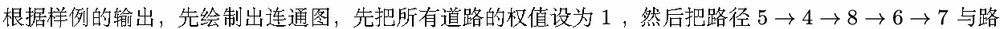

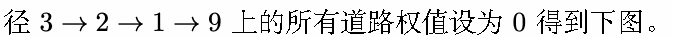

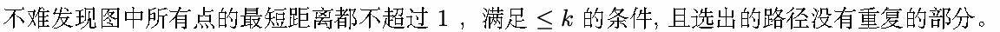

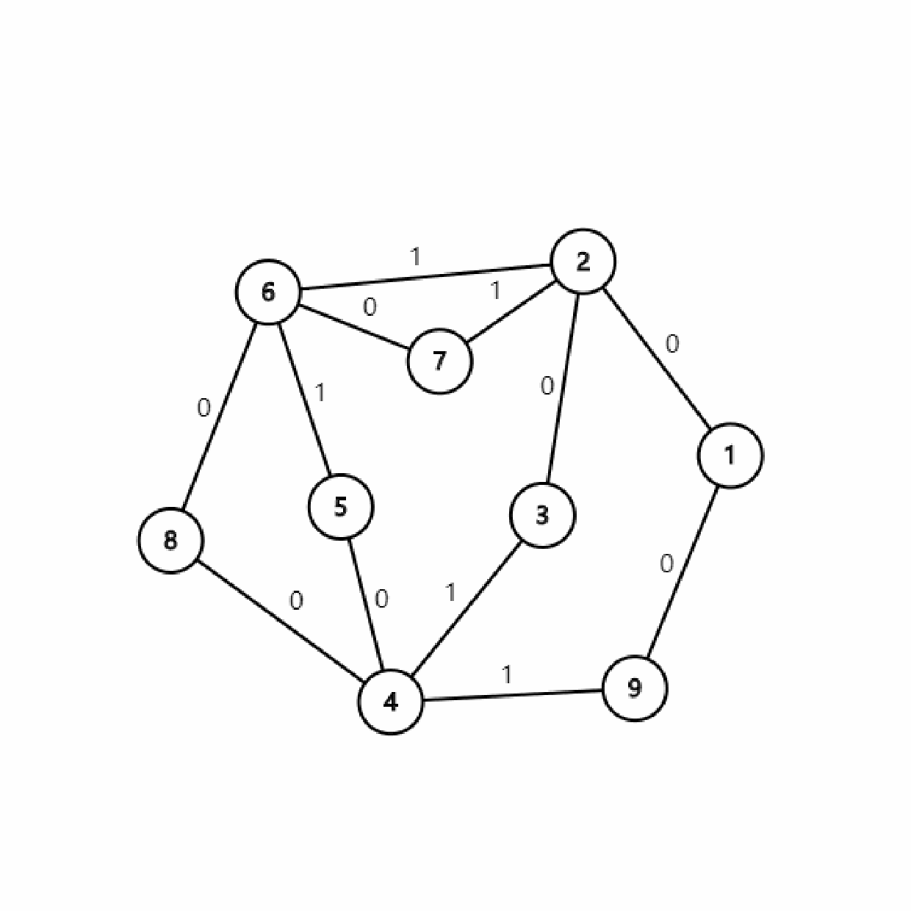
