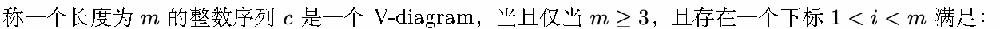
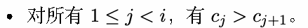
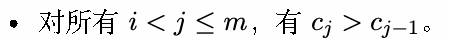
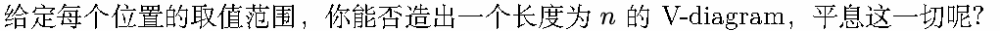
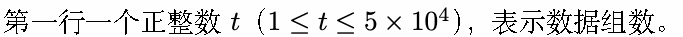
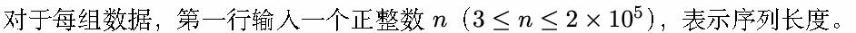
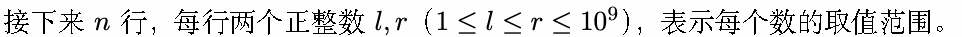
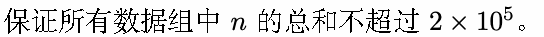
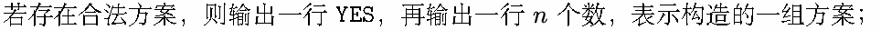

# K. 骤雨

输入文件: standard input

输出文件: standard output

时间限制: 1 second

空间限制: 256 megabytes

让这崩落的世界得到修复，完好如初。

让雨点和雪花在这片它们从未光顾过的荒芜土地上降下。

让毫无生气的死海再次满盈，让沉寂许久的波涛再度翻涌。

让新的法则一锤定音，就此挥之不去。

2024 年 11 月 12 日，漩涡滚滚，巨浪滔天。本只是来参加百年庆典的你，却意外卷入这场风暴之中...

所谓的法则呢，就是这么个东西：









## Input









## Output



若不存在合法方案，只需输出一行 NO。

YES 与 NO 不区分大小写。

## Example

### 样例输入

```text
2
5
8 10
7 10
6 10
5 10
4 10
4
4 5
4 5
4 5
4 5
```

### 样例输出

```text
YES
10 7 8 9 10
NO
```
