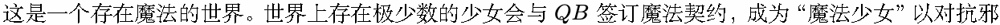
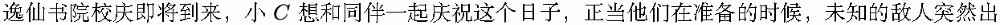
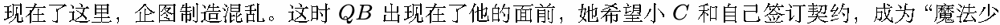
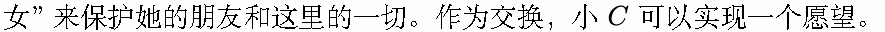
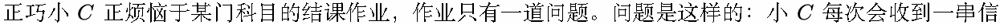
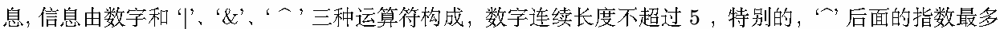
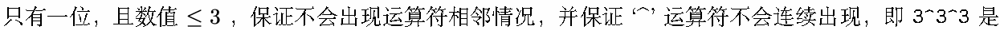
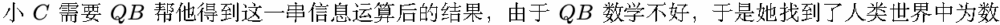
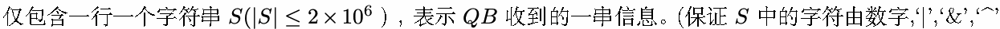

# M. 计算

输入文件: standard input

输出文件: standard output

时间限制: 1 second

空间限制: 256 megabytes

已经没有什么好怕的了。

— 《魔法少女小圆》



恶的魔女保护世界。













错误的。



不多的朋友——你，并向你求助，希望你能够帮帮她。

## Input



构成。)

## Output

输出仅一行, 包含一个数字, 表示你的答案。

## Examples

### 样例输入

```text
1&1^2|1^1
```

### 样例输出

```text
1
```

### 样例输入

```text
11451&1919|810
```

### 样例输出

```text
1851
```

## Note

注意, 在本题中，‘|’,‘&’ 是位运算符，但 ‘^’ 是乘方运算符，具有右结合性。

优先级: 乘方 (^)> 按位与 (&)> 按位或 (|)。
